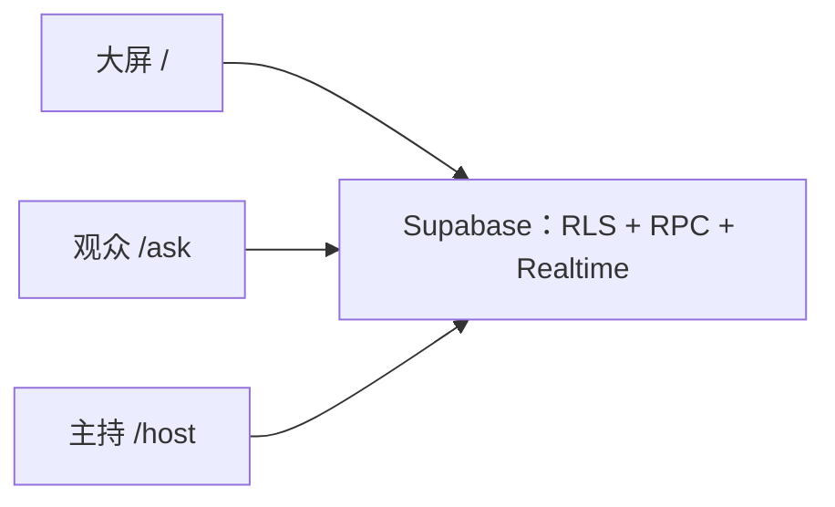

# 提问墙开发计划与数据契约

仓库：[ask-board](https://github.com/JoneyXiao/ask-board)。所有开发只在 `dev` / `feat/*` 进行，本地验收通过后再合并 `main`。本文件是前后端共用的数据契约；改契约须先改本文件，并告知协调者 askboard。

## 目标与约束

现场提问墙：观众投稿并投票，大屏实时更新，主持人用 PIN 把问题标成「开放 / 正在讲 / 已回答」。

- 前端：Next.js 静态导出，部署到 GitHub Pages。本仓库数据层不写页面、不配 Pages。
- 后端：只用 Supabase 的表、RLS、Realtime 和 RPC。不做 Next 服务端或 API Route。
- 浏览器只用 anon / publishable key。`service role` key 严禁写入仓库、前端代码、`.env.example`、文档示例和 GitHub Actions。
- 生产主持 PIN 只存哈希，由用户在 Supabase 侧设置。仓库里至多一个本地种子 PIN（`1234`），必须标明仅限本地。
- 现有云项目（aizhida、foxfire）不是提问墙专用项目。数据层用本地 Supabase CLI 验收；新建云项目须先经用户确认费用。

## 架构

投稿、投票、PIN 校验和改状态全部走 security definer RPC；大屏用 `questions` 的 Realtime 订阅。

## 表结构

### questions

| 列 | 类型 | 约束 |
| --- | --- | --- |
| id | uuid | pk，默认 `gen_random_uuid()` |
| body | text | 非空，1–200 字（以字符计） |
| author_name | text | 可空，最多 40 字 |
| status | text | 非空，默认 `open`，仅限 `open` / `speaking` / `answered`（开放 / 正在讲 / 已回答） |
| vote_count | int | 非空，默认 0，且 `>= 0` |
| created_at | timestamptz | 非空，默认 `now()` |

索引：`(status, vote_count desc)`。为 Realtime 更新补齐 `REPLICA IDENTITY FULL`，并把 `questions` 加入 `supabase_realtime` publication。

### votes

| 列 | 类型 | 约束 |
| --- | --- | --- |
| question_id | uuid | 非空，引用 `questions(id)` ON DELETE CASCADE |
| voter_key | text | 非空，前端 localStorage 中的 UUID |
| created_at | timestamptz | 非空，默认 `now()` |

唯一约束：`(question_id, voter_key)`。索引：`voter_key`。

### host_secrets

单行表（例如 `id boolean primary key default true check (id)`）。

| 列 | 类型 | 约束 |
| --- | --- | --- |
| pin_hash | text | 非空 |
| updated_at | timestamptz | 非空，默认 `now()` |

匿名不可读、不可写。

### host_sessions

| 列 | 类型 | 约束 |
| --- | --- | --- |
| token_hash | text | 非空，唯一 |
| expires_at | timestamptz | 非空，默认 `now() + interval '12 hours'` |
| created_at | timestamptz | 非空，默认 `now()` |

只存会话 token 的哈希，不存明文。匿名不可读、不可写。

## RLS

在 `public` 中上述四张表均启用 RLS。

- `anon` / `authenticated` 只能 `SELECT questions`（所有状态的行；前端自己排序）。
- 不能直接 `INSERT` / `UPDATE` / `DELETE questions`。
- 不能直接访问 `votes` / `host_secrets` / `host_sessions`（无策略即拒绝）。
- 所有写操作走 security definer RPC，并把对应 `EXECUTE` 授给 `anon`（以及 `authenticated`）。撤销函数上的 `PUBLIC` 默认执行权限。

实现要求：security definer 函数放在未暴露的私有 schema（如 `private`），`public` 只保留同名、参数签名一致的 invoker 包装，供 `supabase.rpc('…')` 调用。包装层不得绕过私有函数里的校验。

## RPC

### `submit_question(body text, author_name text, voter_key text)`

- 校验 `body` trim 后 1–200 字，`author_name` 可空，非空则最多 40 字；`voter_key` 非空。
- 按 `voter_key` 限流：同一 key 每小时最多 5 条（看 `questions` 时可用 votes 关联，或单独记录提交；推荐在 `private` 用提交日志或根据可行实现统计，但契约对外仍是「按 voter_key 每小时 5 条」。实现上增加 `private.question_submissions(voter_key, created_at)` 仅供限流，不暴露给 API）。
- 插入 `status='open'`、`vote_count=0`。
- 返回插入的 `questions` 行。

### `toggle_vote(question_id uuid, voter_key text)`

- 问题必须存在，且状态为 `open` 或 `speaking`；`answered` 不可投、也不可取消。
- 已投则删除并 `vote_count - 1`，否则插入并 `+ 1`。
- `vote_count` 由 RPC 与触发器共同保证不为负、与 `votes` 行数一致。
- 返回 `{ vote_count int, voted boolean }`。

### `verify_host_pin(pin text)`

- 用 `pgcrypto` 的 `crypt()` / `bf` 校对 `host_secrets.pin_hash`。
- 成功则写入 `host_sessions`（存 `token_hash`，`expires_at` 默认 12 小时），返回一次性明文 token（建议同时返回 `expires_at`，字段名为 `token`、`expires_at`）。
- 失败时不泄露原因细节，统一报错。

### `set_question_status(question_id uuid, status text, session_token text)`

- 校验 session：`token_hash` 匹配且 `expires_at > now()`。
- `status` 仅限 `open` / `speaking` / `answered`。
- 若标为 `speaking`，把其他 `speaking` 自动改回 `open`（同一时间只允许一条「正在讲」）。
- 返回更新后的 `questions` 行。

生产环境不提供匿名可调用的改 PIN RPC。用户在 Supabase SQL 编辑器（或 service role）自行更新 `host_secrets.pin_hash`。文档只给占位示例，不写真实 PIN，不出现 service role key。

## 本地与生产 PIN

- `supabase/seed.sql`：仅限本地的种子 PIN `1234`（写入 bcrypt 哈希），注释和 README 必须写明「仅限本地，禁止用于生产」。
- 不要把 `1234` 或任何明文 PIN 放进会应用到生产的 migration。
- 生产：用户自行 `update host_secrets set pin_hash = crypt('你的PIN', gen_salt('bf'))`（需 `pgcrypto`）。

## 前端约定（本层不实现，仅锁定契约）

- 大屏 `/`：Realtime 订阅 `questions`；排序为正在讲优先，其次开放按票数降序，已回答靠后。
- 观众 `/ask`：投稿（可选昵称）+ 投票；`voter_key` 为 localStorage UUID。
- 主持 `/host`：调用 `verify_host_pin`，把 session token 放 sessionStorage，再调用 `set_question_status`。
- `.env.example` 只能有 `NEXT_PUBLIC_SUPABASE_URL` 与 `NEXT_PUBLIC_SUPABASE_ANON_KEY`。本地 anon key 从 `supabase status` 读取，不要把 service role 写进示例。

## 本地验收

1. `supabase start` 后迁移与 seed 生效，本地 PIN 为 `1234`。
2. 覆盖：投稿；按 `voter_key` 每小时 5 条限流；投票切换；已回答不可投票；PIN 登录；改状态；同时只有一条「正在讲」；过期/错误 token 被拒绝。
3. 用 advisor 检查安全问题并修复。
4. 全仓库（含文档、示例、未来 workflow）grep 确认无 `service_role` / service role key 实体。
5. 匿名角色直接 `INSERT/UPDATE/DELETE questions` 或读写 `votes` / `host_secrets` / `host_sessions` 必须失败；只能 `SELECT questions` 与调用上述四个 RPC。

## 发布与分支

- 本层负责在空仓库的 `dev` 分支做首次提交并推送 `dev`，禁止推送或合并 `main`，也禁止开到 `main` 的 PR。
- 前端从 `dev` 拉 `feat/frontend`，发布从 `dev` 拉 `feat/pages-deploy`，都 PR 回 `dev`。正式 Pages 部署仅在验收后由 `main` 触发。
